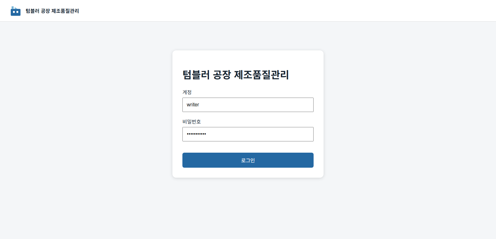
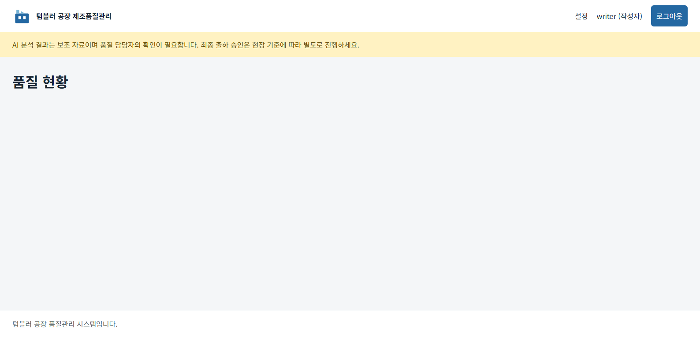

# 1회차: 서버와 로그인

> AI 도구에서 같은 프로젝트 폴더를 열고 프롬프트를 하나씩 보냅니다. 결과를 직접 확인한 뒤 다음으로 넘어갑니다. 오류가 나면 오류 문구를 그대로 보내 해결을 요청하세요. 화면은 예시와 달라도 됩니다.
>
> 실제 현장 정보 대신 수업용 자료를 사용합니다.

## 완성 예시





## 준비

빈 작업 폴더를 만들고 AI 도구에서 엽니다.

## 따라하기

```text
이 폴더에서 웹 서비스를 만들 수 있게 Node.js와 Git이 있는지 확인해줘. 없으면 설치 방법을 알려줘. 로그인이나 설치 승인처럼 내가 해야 할 일은 알려줘.
```

```text
텀블러 공장의 품질을 관리하는 웹 서비스를 만들어줘. Node.js 서버와 HTML, CSS, JavaScript를 사용하고 내 컴퓨터에서 실행해줘. 홈, 검사 목록, 검사 등록, 설정 화면을 만들고 이동할 수 있게 해줘.
```

```text
로그인과 로그아웃을 추가해줘. 로그인하지 않은 사람은 검사 화면에 들어갈 수 없게 해줘. 연습용 계정은 내 컴퓨터에서만 쓰고, 비밀번호는 화면이나 저장소에 공개하지 마.
```

## 직접 확인

- 로그인과 로그아웃을 해 봅니다.
- 로그인 전에는 검사 화면이 열리지 않는지 확인합니다.
