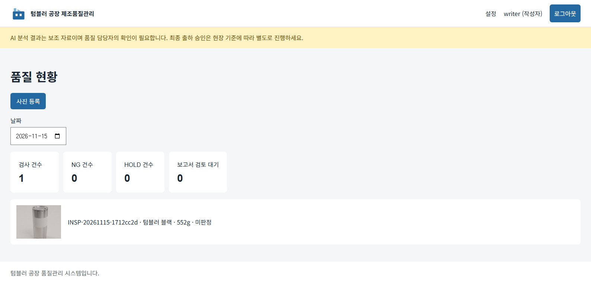
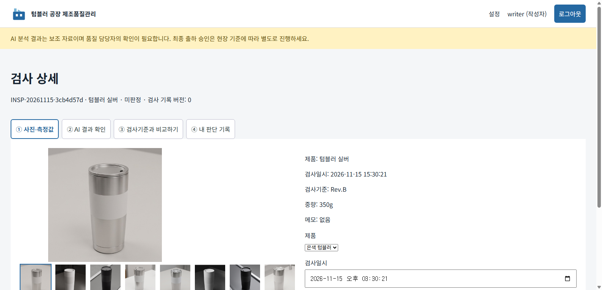

# 2회차: 검사 등록과 품질 현황

> AI 도구에서 같은 프로젝트 폴더를 열고 프롬프트를 하나씩 보냅니다. 결과를 직접 확인한 뒤 다음으로 넘어갑니다. 오류가 나면 오류 문구를 그대로 보내 해결을 요청하세요. 화면은 예시와 달라도 됩니다.
>
> 실제 현장 정보 대신 수업용 자료를 사용합니다.

## 완성 예시





## 준비

1회차 프로젝트 폴더를 열고 서버를 켭니다.

## 따라하기

```text
https://github.com/startup-life/manufacturing-quality-dashboard-student 에서 standards 폴더를 가져와줘. 검사기준 원문은 바꾸지 말아줘. 수업용 사진은 https://github.com/startup-life/manufacturing-quality-student-images 에서 가져와줘.
```

```text
검사 등록 화면에서 텀블러 제품, 검사기준, 검사 시각, 중량, 메모와 사진을 고르고 기록을 저장하게 해줘. 중량을 입력하지 않으면 미측정으로 표시해줘. 고른 제품과 기준의 중량 범위도 보여줘. 내 사진을 직접 올릴 수도 있게 해줘. 검사 기록과 사진은 내 컴퓨터에 저장하고 서버를 다시 켜도 남게 해줘.
```

```text
홈에 오늘 검사 건수와 검사 카드를 보여주고, 검사 목록과 상세 화면을 추가해줘. 상세에서 사진과 입력 내용을 확인하고 수정할 수 있게 해줘.
```

## 직접 확인

- 수업용 사진으로 검사를 등록하고 상세 화면에서 내용을 확인합니다.
- 서버를 다시 켠 뒤에도 기록이 남는지 확인합니다.
