# 3회차 목표: Google 저장(시트·드라이브)

## 3회차 완성 화면

이번 회차가 끝나면 대시보드에서 등록한 검사를 **Google Apps Script(GAS) 웹앱**이 받아 저장합니다. 검사 기록은 Google 시트(내 Google 계정의 표 문서)에 한 줄로 남고, 사진 두 장은 Google 드라이브(내 Google 계정의 파일 보관함)에 저장됩니다. 대시보드에서 같은 검사를 다시 열면 저장한 중량과 사진을 볼 수 있습니다.

### Apps Script 프로젝트와 대시보드의 저장 설정

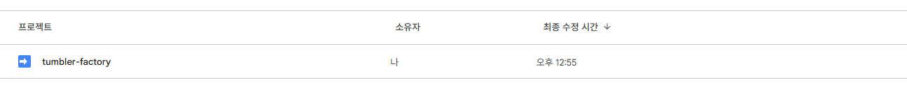

Apps Script의 내 프로젝트 목록에 표시된 tumbler-factory

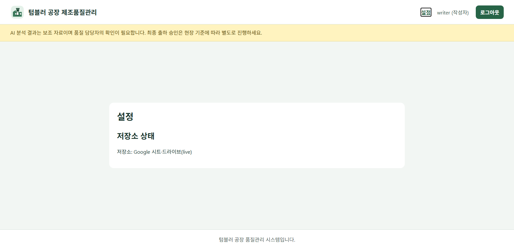

대시보드 설정에 표시된 저장소: Google 시트·드라이브(live)

### 대시보드에서 다시 연 검사

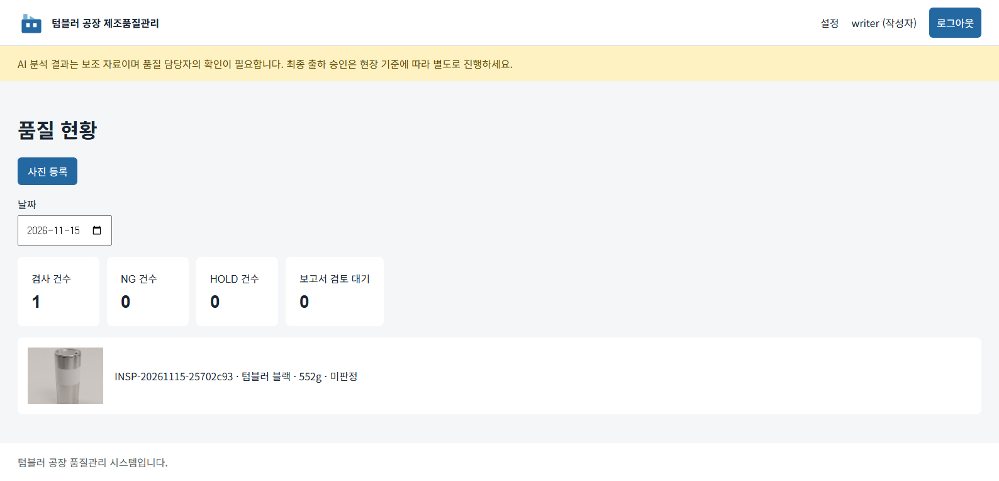

Google 저장으로 등록한 검사가 보이는 홈 품질 현황

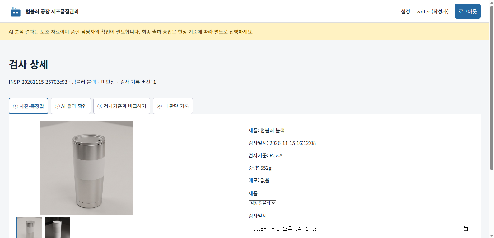

드라이브에서 읽어 온 사진이 보이는 검사 상세

### Google 시트의 검사 기록과 드라이브의 사진


검사 한 줄이 저장된 Google 시트 inspections 탭

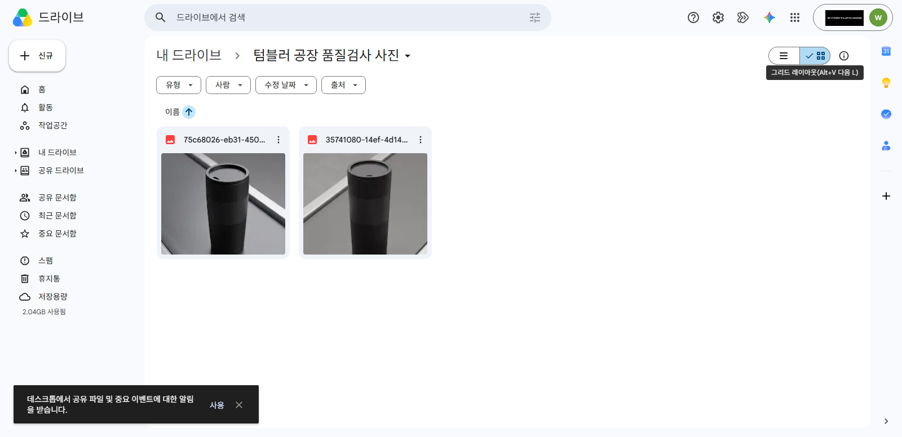

Google 드라이브의 검사 사진 폴더에 저장된 검정 텀블러 사진 두 장

`.env`의 `STORAGE_MODE`로 저장 방식을 고릅니다. `mock`은 내 컴퓨터에, `live`는 Google에 저장합니다.

## 시작 전에

**3-1~3-5는 Cline Desktop에서 진행합니다. 3-6에서는 ego (lite) 브라우저에서 Apps Script API를 켭니다. 3-7~3-8은 Antigravity, 3-9~3-12는 Cline Desktop, 3-13~3-20은 Antigravity를 사용합니다.** 도구를 바꿔도 같은 웹 서비스 폴더를 사용합니다. 실행 중인 서버 창과 ego (lite) 브라우저는 그대로 열어 둡니다.

- 시작 상태: 2회차를 끝낸 웹 서비스 폴더 `C:\ai-class\tumbler-factory`에서 시작합니다.
- 준비물: AI 도구에서 연 웹 서비스 폴더, 수업에 쓸 개인 Google 계정(이 글에서 "수업 계정"이라고 부릅니다. 이 회차의 Google 화면에서는 모두 이 계정을 고릅니다)으로 로그인한 ego (lite) 브라우저, 인터넷, 2회차에 받은 사진 저장소(`C:\ai-class\manufacturing-quality-student-images`).
- 꼭 지킬 것: Apps Script 웹앱 주소는 서버가 Apps Script 코드에 일을 시킬 때 쓰는 주소입니다. 이 주소를 아는 사람은 누구나 내 시트와 사진을 읽고 쓸 수 있습니다. 주소는 `.env`에만 두고 화면 공유, 메신저, 문서에 옮기지 않습니다.
- 이 회차에 새로 나오는 말: **Apps Script 코드**는 내 컴퓨터가 아니라 Google에서 돌아가는 코드입니다. 웹 서비스 폴더의 `gas` 폴더에 만들고 명령으로 Google에 올립니다. **`.env`**는 웹 서비스 폴더에 두는 설정 파일로, 웹앱 주소 같은 비밀 값이 들어갑니다. 고쳐야 하면 AI에게 맡깁니다.
- Google에 저장하면 홈을 여는 데 5~10초, 저장 한 번에 10초쯤 걸립니다. 내 컴퓨터에 저장할 때보다 느린 것이 정상입니다.

2회차를 마친 웹 서비스는 3-1~3-5에서 저장 방식과 Apps Script 명령(npm.cmd run gas:로 시작하는 명령)을 먼저 준비합니다. 이 준비를 이미 마친 웹 서비스는 3-6부터 이어갑니다.

1. Cline Desktop에서 2회차 웹 서비스 폴더를 열고 새 대화를 시작합니다.
2. 서버가 꺼져 있으면 3-1의 지침을 보낸 뒤 AI에게 “화면 서버를 켜 주세요.”라고 보냅니다. ego (lite) 브라우저에서 [대시보드](http://127.0.0.1:4185)를 열고 `writer` / `writer1234!`로 로그인합니다. 2회차 홈의 숫자 카드와 검사 카드가 보이면 됩니다.

## 3-1. 지침 세팅 (Cline Desktop)

```text
이번 회차 문서를 이 프로젝트로 가져오기 위해, class(수업 저장소)를 다시 받아 class/milestone-2의 AGENTS.md와 docs/guide를 이 프로젝트로 가져와 주세요(지금 브랜치는 그대로 두고 그 파일과 폴더만 가져옵니다).
그다음 AGENTS.md를 작업 지침으로 삼아 주세요. 프롬프트에 없는 상세 구현은 docs/guide의 회차 문서와 그 회차 class/milestone-3(완료 브랜치 코드)에서 확인합니다.
지금은 AGENTS.md와 docs/guide의 session-1.md부터 session-3.md까지를 읽기만 하고, 읽은 문서의 끝 표시를 모두 한 줄로 이어서 알려 주세요.
```

- 하는 일: 웹 서비스 폴더에 3회차 보충 문서가 들어오고, AI가 1~3회차 문서를 읽었다는 끝 표시를 알려 줍니다.
- 목표: AI가 이번 회차의 세부 조건을 보충 문서와 완료 코드에서 찾아 따르게 합니다. 3-1은 Cline Desktop에서 한 번 진행합니다. 이후 도구를 바꿀 때는 해당 단계의 상자 전체를 한 번에 보냅니다.
- 완료 기준: 파일 탐색기(폴더와 파일을 보는 Windows 프로그램)의 `docs\guide` 폴더에 `session-3.md`가 새로 생깁니다(`files` 폴더가 함께 있어도 맞습니다). AI 답의 마지막 줄에 `1회차-은색컵-4185 2회차-저울눈금-354 3회차-초록시트-Asia/Seoul`이 한 줄로 이어 보입니다. 끝 표시의 숫자는 서버 번호와 상관없습니다.

<details>
<summary>지침을 보냈는데 끝 표시가 없거나 글자가 다를 때</summary>

보이지 않거나 글자가 다르면 한 번 더 보냅니다. 그래도 같으면 AI에게 "지침을 다시 맞추기 위해, `class/milestone-2`의 `AGENTS.md`와 `docs/guide`를 다시 가져와(지금 브랜치는 그대로 둡니다) `AGENTS.md`와 `docs/guide`의 `session-1.md`부터 `session-3.md`까지를 처음부터 다시 읽고, 읽은 문서의 끝 표시를 모두 한 줄로 이어서 알려 주세요."라고 보냅니다.

</details>

## 3-2. 저장 방식 고르기 (Cline Desktop)

```text
기록을 내 컴퓨터와 Google 가운데 골라 저장하도록, 서버에 .env로 저장 방식을 고르는 기능을 추가해 주세요.
Google에 실제로 저장하는 기능은 뒤 번호에서 만듭니다.
자세한 내용은 docs/guide/session-3.md의 "저장 방식 고르기"를 참고해 주세요.
```

- 하는 일: 서버가 `.env`의 `STORAGE_MODE`를 읽어 저장 방식을 정하고, 서버 창과 설정 화면에 지금 저장 방식이 보입니다.
- 목표: 기록을 내 컴퓨터와 Google 가운데 골라 저장하게 합니다. Google에 실제로 저장하는 일은 뒤 번호에서 만듭니다.
- 할 일: 브라우저를 새로고침한 뒤 다시 로그인합니다. 화면 맨 위 줄의 "설정"을 누릅니다.
- 완료 기준: 서버 창과 설정 화면에 `저장소: 내 컴퓨터(mock)`가 보입니다. `.env`는 아직 만들지 않아도 됩니다.

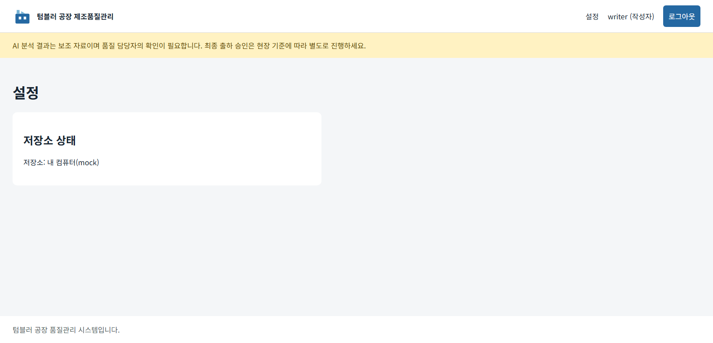

3-2 저장소: 내 컴퓨터(mock)가 보이는 설정 화면

## 3-3. Apps Script 명령 1: 로그인·만들기·올리기 (Cline Desktop)

```text
Apps Script 코드를 명령 한 줄로 다루기 위해, 웹 서비스에 gas:login, gas:create, gas:push 명령을 추가해 주세요.
지금은 만들기만 합니다.
자세한 내용은 docs/guide/session-3.md의 "Apps Script 명령"을 참고해 주세요.
```

- 하는 일: 웹 서비스에 `gas:login`, `gas:create`, `gas:push` 명령이 생깁니다. 아직 실행하지 않습니다.
- 목표: 명령 창에서 Google에 로그인하고, Apps Script 프로젝트(Google에서 코드를 보관하고 실행하는 프로젝트)를 만들고, 코드를 올리게 합니다.
- 완료 기준: 웹 서비스 폴더의 `package.json`에 `gas:login`, `gas:create`, `gas:push`가 등록되어 있습니다.

## 3-4. Apps Script 명령 2: 웹앱 배포 (Cline Desktop)

```text
서버가 Apps Script 코드에 일을 시킬 주소를 만들기 위해, 웹 서비스에 gas:deploy, gas:redeploy 명령을 추가해 주세요.
지금은 만들기만 합니다.
자세한 내용은 docs/guide/session-3.md의 "Apps Script 명령"을 참고해 주세요.
```

- 하는 일: 웹 서비스에 `gas:deploy`, `gas:redeploy` 명령이 생깁니다. 아직 실행하지 않습니다.
- 목표: 서버가 Apps Script 코드에 일을 시킬 웹앱 주소를 만들고, 코드를 고친 뒤 같은 주소를 새 버전으로 바꾸게 합니다.
- 완료 기준: 웹 서비스 폴더의 `package.json`에 `gas:deploy`와 `gas:redeploy`가 등록되어 있습니다.

## 3-5. Apps Script 명령 3: 열기·시트 준비 (Cline Desktop)

```text
권한 승인과 시트 준비를 명령 한 줄로 하기 위해, 웹 서비스에 gas:open, gas:init 명령을 추가해 주세요.
자세한 내용은 docs/guide/session-3.md의 "Apps Script 명령"을 참고해 주세요.
```

- 하는 일: 웹 서비스에 `gas:open`, `gas:init` 명령이 생깁니다. 웹앱 주소가 아직 없어 지금 치면 안내만 나옵니다.
- 목표: 권한 승인과 시트 준비를 명령 한 줄로 하게 합니다.
- 완료 기준: 웹 서비스 폴더의 `package.json`에 `gas:open`과 `gas:init`이 등록되어 있습니다. 첫 실행은 웹앱을 배포한 뒤 3-18과 3-19에서 합니다.

## 3-6. Apps Script API 켜기 (ego (lite) 브라우저)

2회차에서 만든 웹 서비스를 Google 시트와 드라이브에 연결하려면 수업 계정에서 Apps Script API를 켭니다.

1. ego (lite) 브라우저에서 [Apps Script 설정](https://script.google.com/home/usersettings)을 엽니다. 오른쪽 위 계정이 수업에 사용할 Google 계정인지 확인합니다.
2. **Google Apps Script API**를 누릅니다.

   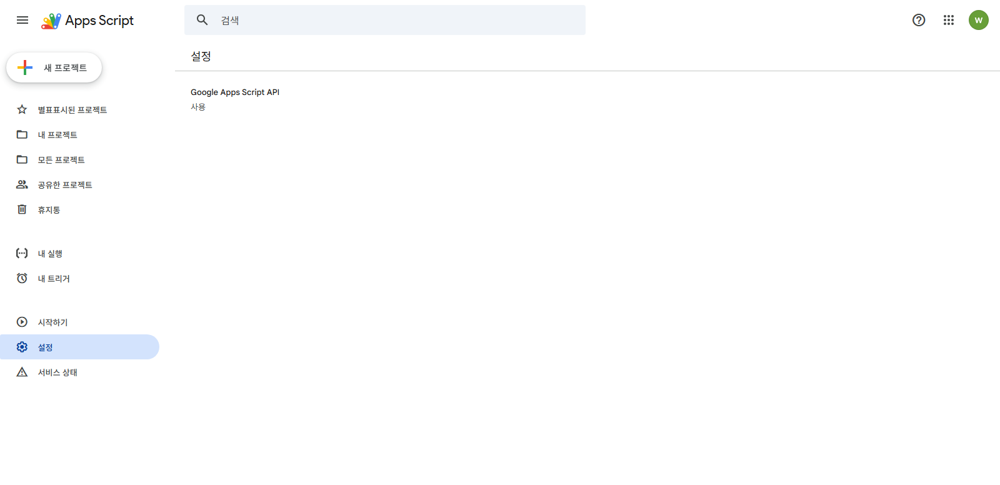

   Apps Script 설정에서 Google Apps Script API 선택

3. 스위치가 꺼져 있으면 눌러 켭니다. 이미 **사용**으로 되어 있으면 그대로 둡니다.

   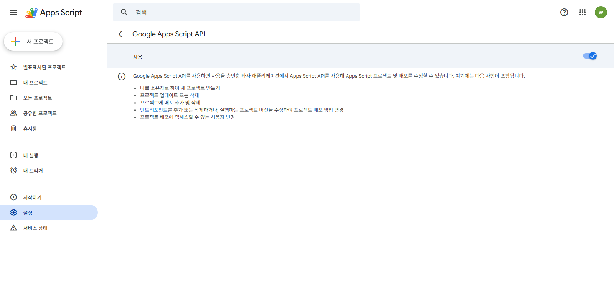

   Google Apps Script API가 사용으로 켜진 화면

- 하는 일: 수업에 쓸 Google 계정에서 Apps Script API를 켭니다.
- 목표: 내 컴퓨터에서 수업용 코드를 Google에 올릴 수 있게 합니다.
- 완료 기준: 스위치가 켜지고 **사용**이라고 표시됩니다.

## 3-7. Google에 로그인하기 (할 일) (Antigravity)

Antigravity에서 같은 웹 서비스 폴더를 열고 새 대화를 시작합니다. **Gemini 3.8 Flash**와 추론 단계 **Low**를 고른 뒤, 아래 상자를 구분선 아래까지 한 번에 보냅니다.

```text
clasp가 처음이면 npx로 수업 버전(3.4.1)을 받아 주세요. 이미 설치했거나 설치에 실패한 적이 있으면 clasp의 npx 캐시만 비우고 다시 받아 주세요.
캐시를 따로 비우기 어려우면 새 npm 캐시 폴더를 사용해 주세요. 같은 캐시에서 clasp 버전이 3.4.1인지 확인해 주세요.
그 상태에서 npm.cmd run gas:login을 실행하고, 로그인 주소를 알려 준 뒤 로그인이 끝날 때까지 기다려 주세요.

---
Cline Desktop에서 3-5까지 Apps Script 명령을 준비했고, 3-6은 ego (lite) 브라우저에서 수업 계정의 Apps Script API를 켰습니다.
같은 웹 서비스 폴더의 AGENTS.md와 docs/guide/session-3.md를 참고해 주세요. 지금은 따라하기 교재의 3-7입니다. https://github.com/startup-life/manufacturing-quality-dashboard-student/blob/main/follow-along/session-3.md
```

- 하는 일: clasp(내 컴퓨터의 연결 도구)를 수업용 Google 계정에 연결합니다.
- 목표: 다음 단계에서 이 계정에 Apps Script 프로젝트를 만들 수 있게 합니다.

1. 열린 브라우저에서 **3-6에서 확인한 수업 계정**을 선택합니다. 브라우저가 열리지 않으면 AI가 알려 준 로그인 주소를 ego (lite) 브라우저에 붙여 넣습니다.

   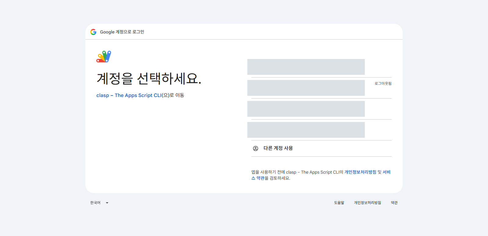

   Google 계정 선택 화면. 계정 이름과 이메일은 가렸습니다.

2. 권한 안내를 확인하고 **계속** 또는 **허용**을 누릅니다. 체크 상자가 나오면 필요한 항목을 선택합니다.

   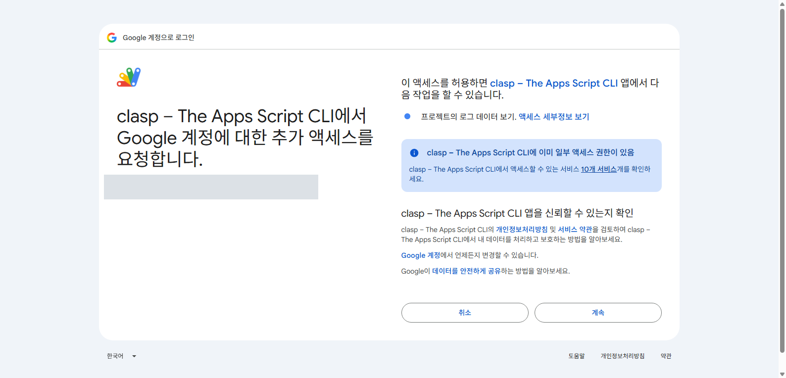

   Google 권한 동의 화면. 아래의 계속 버튼을 누릅니다.

3. 아래처럼 로그인 완료 글이 나오면 탭을 닫고 AI에게 완료했다고 알립니다.

   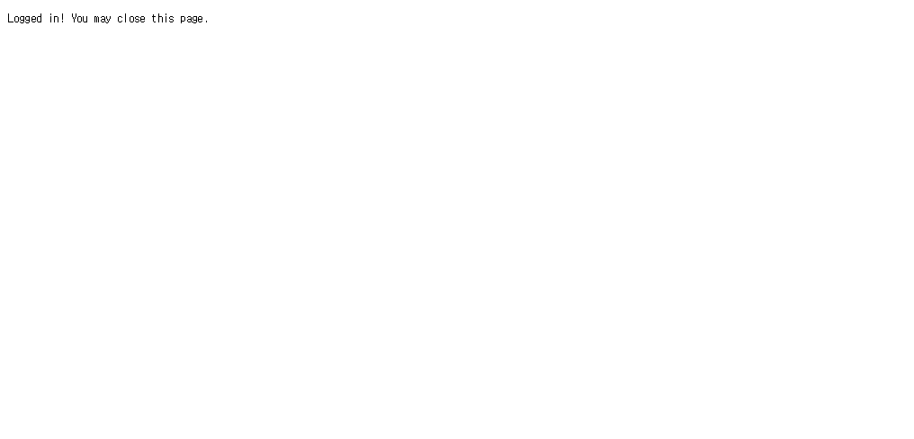

   Google 로그인 완료 화면

- 완료 기준: AI가 로그인 명령이 성공했다고 알려 줍니다.

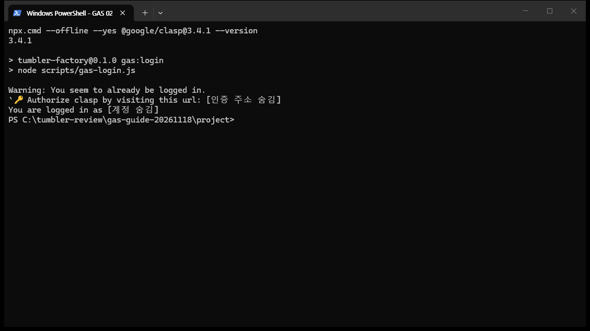

clasp 버전 3.4.1과 로그인 성공 메시지

<details>
<summary>로그인 주소가 안 나오고 npm warn만 보일 때</summary>

처음 1분 정도는 설치 중일 수 있습니다. 잠시 기다립니다. `.env not found. Continuing without it.`이 먼저 나와도 계속할 수 있습니다. 계속 실패하면 오류 글을 AI에게 보냅니다.

</details>

<details>
<summary>이미 로그인했다는 경고나 본인 확인 화면이 나올 때</summary>

`Warning: You seem to already be logged in.` 뒤에 주소가 나오면 그 주소를 열어 수업 계정으로 로그인합니다. 확인 화면에서는 앱 이름이 **clasp**인지, 계정이 수업 계정인지 확인한 뒤 안내를 따릅니다.

</details>

## 3-8. Apps Script 프로젝트 만들기 (할 일) (Antigravity)

AI에게 아래 문장을 보냅니다.

```text
Apps Script 코드를 올릴 프로젝트를 만들기 위해 npm.cmd run gas:create를 실행해 주세요.
이미 프로젝트가 있으면 새로 만들지 말고 알려 주세요.
```

- 하는 일: Google에서 수업 코드를 보관하고 실행할 프로젝트를 만듭니다.
- 목표: 내 프로젝트 목록에서 이번 수업에 쓸 `tumbler-factory`를 찾을 수 있게 합니다.

1. AI가 **프로젝트를 만들었습니다.**라고 알려 주면 [Apps Script](https://script.google.com/home)를 엽니다.
2. 오른쪽 위에서 수업 계정을 확인하고 **내 프로젝트** 목록을 봅니다.

   

   내 프로젝트 목록에 생성된 tumbler-factory

- 완료 기준: 목록에 **tumbler-factory**가 보입니다. 같은 이름이 여럿이면 수정 시간이 가장 최근인 것을 봅니다.

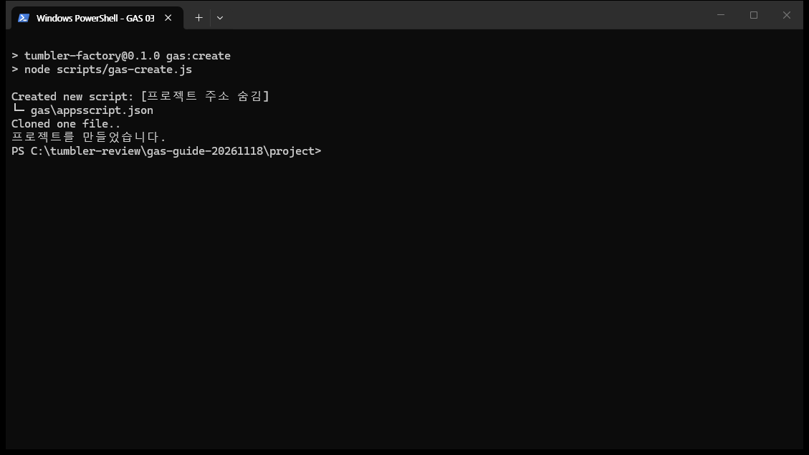

Apps Script 프로젝트가 생성된 뒤의 터미널 메시지

<details>
<summary>프로젝트를 만들 때 invalid_grant 또는 Apps Script API 오류가 나올 때</summary>

`invalid_grant`이면 3-7에서 다시 로그인합니다. `Apps Script API` 오류이면 3-6에서 수업 계정의 스위치가 **사용**인지 확인하고 몇 분 뒤 다시 시도합니다. 다른 오류는 나온 글을 AI에게 보냅니다.

</details>

<details>
<summary>이미 프로젝트가 있거나 .env 파일이 없다고 나올 때</summary>

이미 프로젝트가 있으면 같은 프로젝트를 사용합니다. `.env not found. Continuing without it.`은 이 단계에서 계속 진행해도 된다는 안내입니다.

</details>

## 3-9. Apps Script 코드와 설정 파일 만들기 (Cline Desktop)

**여기서 Cline Desktop으로 돌아갑니다. 3-12까지 이 대화에서 진행합니다.**

3-5까지 사용한 Cline Desktop 대화를 다시 열고, 같은 웹 서비스 폴더에서 아래 상자 전체를 한 번에 보냅니다.

```text
Apps Script 코드를 만들기 위해, gas 폴더에 Apps Script 코드의 틀과 설정 파일을 추가해 주세요.
시트와 사진을 다루는 일은 다음 번호부터 더합니다.
자세한 내용은 docs/guide/session-3.md의 "Apps Script 코드의 틀"을 참고해 주세요.

---
Antigravity에서 3-8까지 수업 계정으로 로그인하고 Google에 tumbler-factory 프로젝트를 만들었습니다. 같은 웹 서비스 폴더에 .clasp.json이 있습니다.
지금은 따라하기 교재의 3-9입니다. https://github.com/startup-life/manufacturing-quality-dashboard-student/blob/main/follow-along/session-3.md
```

- 하는 일: 내 컴퓨터에 Google로 올릴 파일 두 개를 준비합니다.
- 목표: Google이 할 일과, 시간대·필요한 권한을 서로 다른 파일에 적어 둡니다.

AI가 마치면 파일 탐색기에서 웹 서비스 폴더 안의 `gas` 폴더를 엽니다.

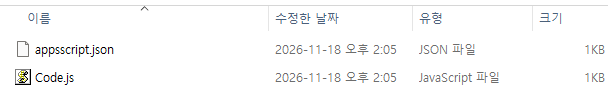

gas 폴더에 보이는 appsscript.json과 Code.js

- 완료 기준: `Code.js`와 `appsscript.json` 두 파일이 보이면 완료입니다. Google에 올리는 작업은 3-17에서 합니다.

## 3-10. 시트와 사진 폴더를 준비하는 기능 추가하기 (Cline Desktop)

AI에게 아래 문장을 보냅니다.

```text
검사 기록을 담을 곳을 준비하기 위해, 내 드라이브에 시트와 사진 폴더를 만드는 일을 Apps Script 코드에 추가해 주세요.
자세한 내용은 docs/guide/session-3.md의 "Apps Script 코드의 일 여섯 가지"를 참고해 주세요.
```

- 하는 일: 검사 기록용 시트와 사진용 폴더를 만드는 기능을 코드에 추가합니다.
- 목표: 나중에 명령 한 번으로 시트와 폴더를 만들 수 있게 합니다.
- 완료 기준: AI가 `gas/Code.js`에 `setup`을 추가했다고 알려 주면 완료입니다. 실제 시트와 사진 폴더는 3-19에서 만듭니다.

## 3-11. 시트의 검사 기록 읽고 쓰기 (Cline Desktop)

AI에게 아래 문장을 보냅니다.

```text
Apps Script 코드에 시트에서 검사 기록을 읽는 기능과 새 기록을 한 줄 추가하는 기능을 넣어 주세요.
기존 기록을 수정할 때는 해당 기록을 찾아 지정한 항목의 값만 바꿔 주세요.
자세한 내용은 docs/guide/session-3.md의 "Apps Script 코드의 일 여섯 가지"를 참고해 주세요.
```

- 하는 일: 시트에서 기존 검사 기록을 읽고 새 검사를 한 줄 추가하는 기능을 만듭니다.
- 목표: 이미 기록한 중량을 고칠 때도 해당 검사의 필요한 값만 바꿀 수 있게 합니다.
- 완료 기준: AI가 `gas/Code.js`에 읽기(`read`), 추가(`append`), 수정(`update`) 기능을 넣었다고 알려 주면 완료입니다.

## 3-12. 사진을 드라이브에 저장하고 불러오기 (Cline Desktop)

AI에게 아래 문장을 보냅니다.

```text
사진을 내 드라이브에 두기 위해, Apps Script 코드에 사진을 저장하고 꺼내는 일을 추가해 주세요.
끝나면 Apps Script 코드의 일 여섯 가지가 모두 있는지 알려 주세요.
자세한 내용은 docs/guide/session-3.md의 "Apps Script 코드의 일 여섯 가지"를 참고해 주세요.
```

- 하는 일: 검사 사진을 드라이브 폴더에 저장하고 꺼내는 기능을 추가합니다.
- 목표: 나중에 같은 사진을 다시 불러올 수 있게 합니다.
- 완료 기준: AI가 `setup`, `read`, `append`, `update`, `savePhoto`, `getPhoto` 여섯 기능이 모두 있다고 알려 주면 완료입니다.

## 3-13. 서버에서 Apps Script 웹앱으로 요청 보내기 (Antigravity)

**여기서 Antigravity로 돌아갑니다. 3-20까지 Antigravity를 사용합니다.**

3-8까지 사용한 Antigravity 대화를 다시 엽니다. 같은 웹 서비스 폴더가 열려 있고 모델이 **Gemini 3.8 Flash**, 추론 단계가 **Low**인지 확인한 뒤 아래 상자 전체를 한 번에 보냅니다.

```text
Google 저장일 때 서버가 Apps Script 코드에 일을 시키도록, 서버에 웹앱 주소로 요청을 보내는 기능을 추가해 주세요.
자세한 내용은 docs/guide/session-3.md의 "서버가 Google을 쓰는 법"을 참고해 주세요.

---
Cline Desktop에서 3-12까지 gas 폴더에 검사 기록을 시트에 쓰고 읽는 코드와 사진을 드라이브에 저장하고 불러오는 코드를 만들었습니다.
같은 웹 서비스 폴더에서 이어 갑니다. 지금은 따라하기 교재의 3-13입니다. https://github.com/startup-life/manufacturing-quality-dashboard-student/blob/main/follow-along/session-3.md
```

- 하는 일: 대시보드 서버가 앞에서 만든 Apps Script 코드에 요청을 보내고 답을 받도록 연결합니다.
- 목표: 나중에 Google에 저장할 때 이 연결을 씁니다. 지금은 내 컴퓨터에 저장하므로 설정 화면은 그대로입니다.

AI가 오류 없이 마쳤다고 알려 주면, 대시보드 오른쪽 위에서 **설정**을 누릅니다.

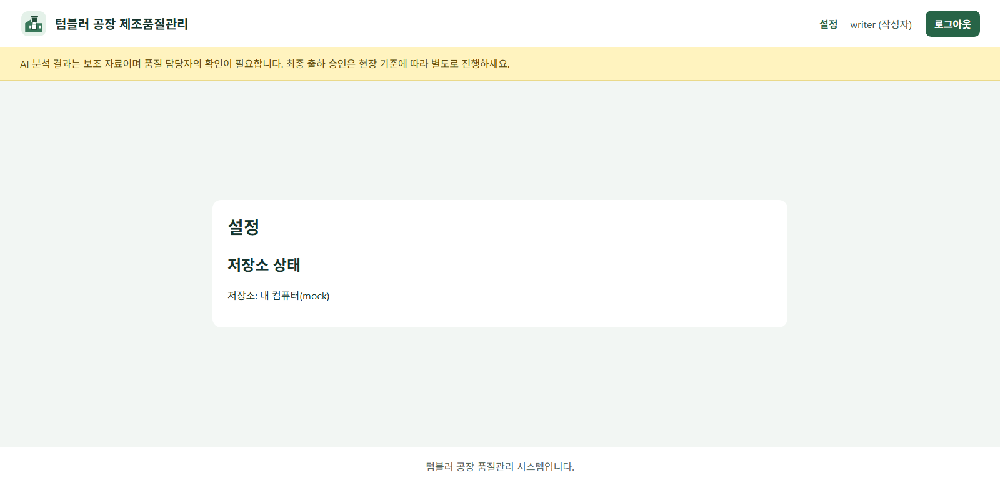

설정 화면의 저장소 상태

- 완료 기준: 서버 창과 설정 화면에 `저장소: 내 컴퓨터(mock)`가 보이면 완료입니다. Google 저장으로 전환하는 단계는 뒤에 나옵니다.

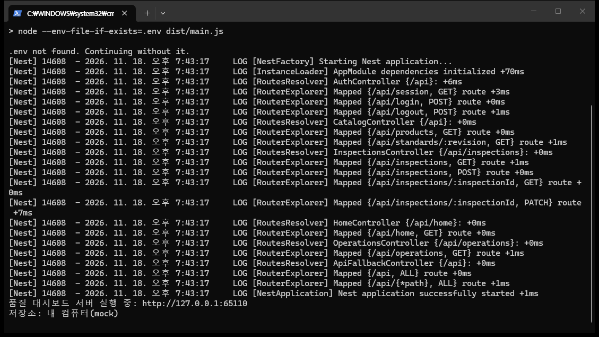

서버 실행 중인 창입니다. 마지막 줄에 ‘저장소: 내 컴퓨터(mock)’가 보이면 이 창을 그대로 열어 둡니다.

## 3-14. 서버에서 Google 시트의 검사 기록 읽고 쓰기 (Antigravity)

AI에게 아래 문장을 보냅니다.

```text
Google 저장일 때도 화면이 똑같이 동작하도록, 서버에 시트에서 검사와 사진을 읽고 시트에 쓰는 기능을 추가해 주세요.
등록은 다음 번호에서 만듭니다.
자세한 내용은 docs/guide/session-3.md의 "서버가 Google을 쓰는 법"을 참고해 주세요.
```

- 하는 일: 서버를 3-11에서 만든 시트 읽기·추가·수정 기능에 연결합니다.
- 목표: 나중에 대시보드에서 검사 카드를 열거나 중량을 고치면 Google 시트의 기록을 읽거나 수정할 수 있게 합니다. 지금은 내 컴퓨터에 저장하므로 화면은 그대로입니다.

AI가 오류 없이 마쳤다고 알려 주면, 대시보드 홈에서 앞서 등록한 검사 카드를 찾습니다.

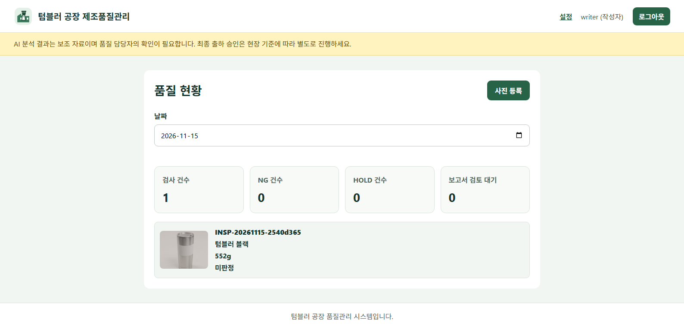

품질 현황 홈에 표시된 기존 검사 카드

검사 카드를 눌러 **검사 상세**를 엽니다.

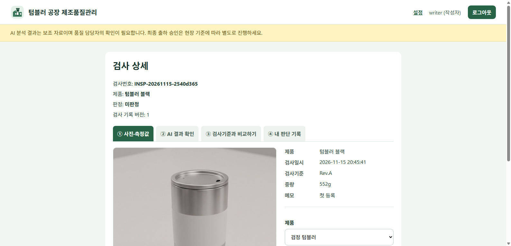

검사 상세의 사진과 측정값

- 완료 기준: 아직 내 컴퓨터에 저장하는 단계이므로 기존 검사 사진과 측정값이 전과 같으면 완료입니다.

## 3-15. 새 검사의 사진과 기록을 Google에 저장하기 (Antigravity)

AI에게 아래 문장을 보냅니다.

```text
Google 저장일 때 검사를 등록하도록, 서버에 사진을 드라이브에 올리고 검사를 시트에 저장하는 기능을 추가해 주세요.
자세한 내용은 docs/guide/session-3.md의 "서버가 Google을 쓰는 법"을 참고해 주세요.
```

- 하는 일: 새 검사를 등록하면 사진은 드라이브 폴더에, 중량과 메모 같은 기록은 시트에 저장되도록 연결합니다.
- 목표: 지금은 등록 기능을 준비합니다. 실제로 Google에 저장된 결과는 3-20에서 확인합니다.
- 완료 기준: AI가 등록 기능을 오류 없이 추가했다고 알려 주면 완료입니다.

## 3-16. 저장한 사진을 홈과 검사 상세에 보여 주기 (Antigravity)

AI에게 아래 문장을 보냅니다.

```text
드라이브에 둔 사진이 화면에 보이도록, 서버에 드라이브 사진을 받아 상세와 홈 카드에 보내 주는 기능을 추가해 주세요.
자세한 내용은 docs/guide/session-3.md의 "서버가 Google을 쓰는 법"을 참고해 주세요.
```

- 하는 일: 저장한 사진을 홈과 검사 상세에 표시하는 기능을 연결하고, 내 컴퓨터에 검사 한 건을 등록합니다.
- 목표: 3-15에서 저장하도록 연결한 사진을 나중에 대시보드에서 다시 볼 수 있게 합니다. 검사 상세에 앞에서 고른 사진이 보이는지 확인합니다.

1. 대시보드를 새로고침하고 다시 로그인합니다. 왼쪽 위 로고를 눌러 홈으로 간 뒤 **사진 등록**을 누릅니다.
2. 제품은 **검정 텀블러**를 고르고, 중량 칸에는 **550**을 입력합니다.
3. **파일 선택**을 눌러 검정 텀블러 사진 `TUM-PRC-003.jpg`를 고릅니다.
4. **검사 등록**을 누릅니다.

   

   검사 상세에 표시된 검정 텀블러 사진과 중량 550g

- 완료 기준: 서버 창에 `저장소: 내 컴퓨터(mock)`가 표시되고, 새 검사 상세의 **① 사진·측정값**에 고른 사진과 **550g**이 보이면 완료입니다. 실제 드라이브에 저장한 사진은 교재 3-20에서 확인합니다.

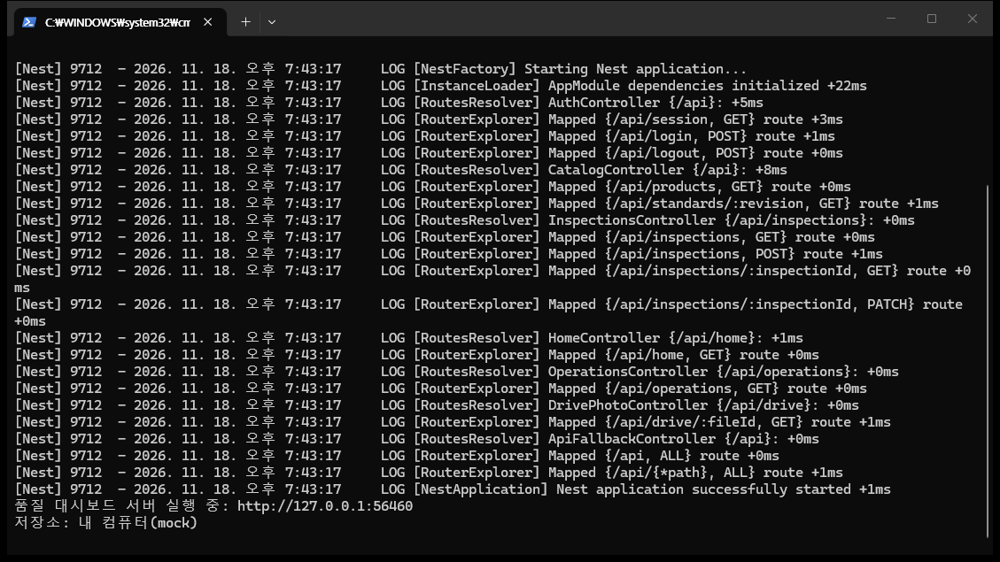

서버 실행 중인 창입니다. 마지막 줄에 ‘저장소: 내 컴퓨터(mock)’가 보이면 이 창을 그대로 열어 둡니다.

<details>
<summary>Google에 배포하기 전인데 설정에 Google 시트·드라이브(live)가 보일 때</summary>

AI에게 “저장 방식을 `mock`으로 바꾸고 서버를 다시 켜 주세요.”라고 보냅니다. 설정에 **내 컴퓨터(mock)**가 보이면 이어갑니다. 이미 Google에 저장한 기록은 그대로 남습니다.

</details>

## 3-17. Google에 코드를 올리고 웹앱 주소 만들기 (할 일) (Antigravity)

AI에게 아래 문장을 보냅니다.

```text
이 웹 서비스 폴더에서 npm.cmd run gas:push를 실행해 주세요. 마지막 줄에 “Google에 코드를 올렸습니다.”가 나오면 npm.cmd run gas:deploy를 실행해 주세요.
웹앱 주소가 .env에 저장됐는지 확인하고, 주소는 보여 주지 말고 결과만 알려 주세요.
```

- 하는 일: 지금까지 내 컴퓨터에서 만든 코드를 3-8에서 만든 Apps Script 프로젝트에 올립니다.
- 목표: 대시보드가 Google에 검사 기록이나 사진을 요청할 주소를 만들어 웹 서비스 설정 파일에 저장합니다.
- 완료 기준: 먼저 “Google에 코드를 올렸습니다.”가 나오고, 배포가 끝나면 “.env에 웹앱 주소를 적었습니다.”와 “다음: npm.cmd run gas:open”이 차례로 보이면 완료입니다.

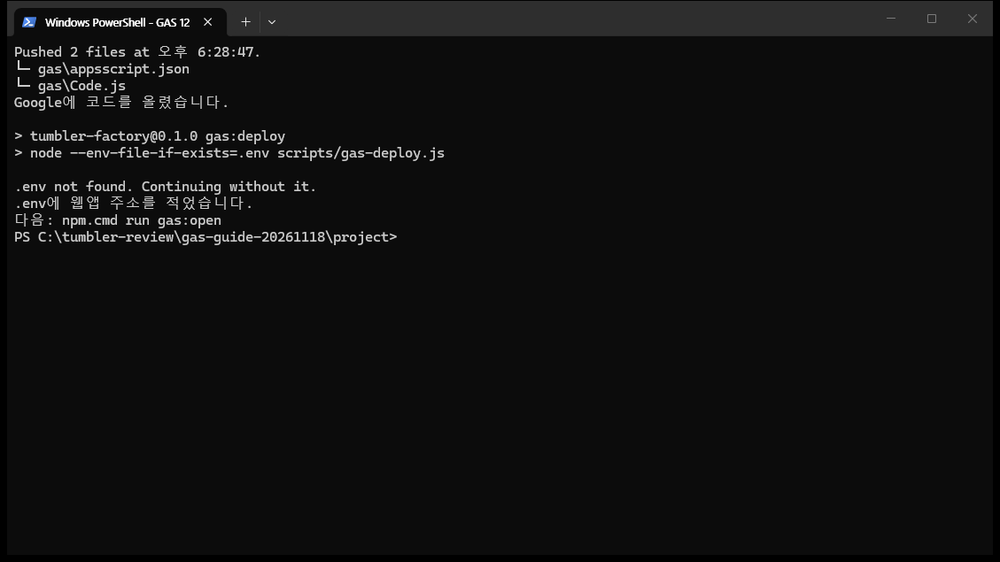

코드 두 파일을 올리고 웹앱 주소를 저장한 실제 터미널 출력

<details>
<summary>배포 중 로그인이 만료됐거나 웹앱 번호를 찾지 못했다고 나올 때</summary>

3-7에서 다시 로그인한 뒤 3-17 상자를 다시 보냅니다. 다른 오류라면 다음 명령을 실행하기 전에 오류 글을 AI에게 보냅니다. `Pushed 2 files` 또는 `Script is already up to date.` 뒤에 “Google에 코드를 올렸습니다.”가 나오면 업로드 성공입니다. 배포 전의 `.env not found. Continuing without it.` 안내는 정상입니다.

</details>

<details>
<summary>이미 웹앱 주소가 있다고 나올 때</summary>

AI에게 `npm.cmd run gas:redeploy`로 같은 주소에 다시 배포해 달라고 합니다. Apps Script 코드를 고쳤다면 `gas:push`가 성공한 뒤 `gas:redeploy`를 실행합니다.

</details>

<details>
<summary>clasp 오류가 계속돼 Apps Script 편집기에서 배포해야 할 때</summary>

1. 3-9~3-16의 코드를 준비한 뒤 [Apps Script](https://script.google.com/home)를 엽니다. 3-8에서 만든 **tumbler-factory**를 선택합니다. 프로젝트를 만들지 못했다면 새로 만듭니다.
2. 편집기의 기본 코드를 웹 서비스 폴더의 `gas/Code.js` 내용으로 바꿔 저장합니다. 프로젝트 설정에서 **편집기에 appsscript.json 매니페스트 파일 표시**를 켜고, 편집기의 `appsscript.json`도 `gas/appsscript.json`과 같게 저장합니다.
3. 화면을 공유 중이면 공유를 멈춥니다. **배포**에서 **새 배포**를 누르고 유형을 **웹 앱**으로 선택합니다. 실행 사용자는 **나**, 액세스 권한은 **모든 사용자**로 골라 배포합니다.
4. `/exec`로 끝나는 웹앱 주소를 복사해 웹 서비스 폴더의 `.env`에 `GAS_WEBAPP_URL` 값으로 저장하고 `STORAGE_MODE=live`를 설정합니다. 3-18에서 권한 승인을 확인한 뒤 3-19를 진행합니다.
5. 나중에 Apps Script 코드를 다시 올릴 때 `.clasp.json`이 없다면 AI에게 방금 배포한 프로젝트와 웹 서비스 폴더를 연결해 달라고 합니다.

</details>

## 3-18. Google에서 시트와 드라이브 사용 허용하기 (할 일) (Antigravity)

**화면을 공유 중이면 잠시 멈추고 Google 계정을 확인합니다.** 3-19까지는 개인 웹앱과 시트 주소가 보입니다. ego (lite) 브라우저의 Google 화면 오른쪽 위 계정 그림을 눌러 3-7에서 쓴 수업 계정이 골라져 있는지 봅니다. Google 계정이 여러 개 로그인돼 있으면 권한 화면 대신 “현재 파일을 열 수 없습니다”가 뜰 수 있습니다.

AI에게 아래 문장을 보냅니다.

```text
이 웹 서비스 폴더에서 npm.cmd run gas:open을 실행해 주세요.
권한을 승인할 브라우저 창이 열리면 알려 주세요.
```

- 하는 일: 방금 배포한 `tumbler-factory`에 수업 계정으로 한 번 권한을 줍니다.
- 목표: 웹앱이 내 Google 시트에 검사 기록을 쓰고 드라이브에 사진을 보관할 수 있게 합니다.

AI가 명령 실행을 마쳤다고 알려 주면 열린 브라우저를 봅니다.

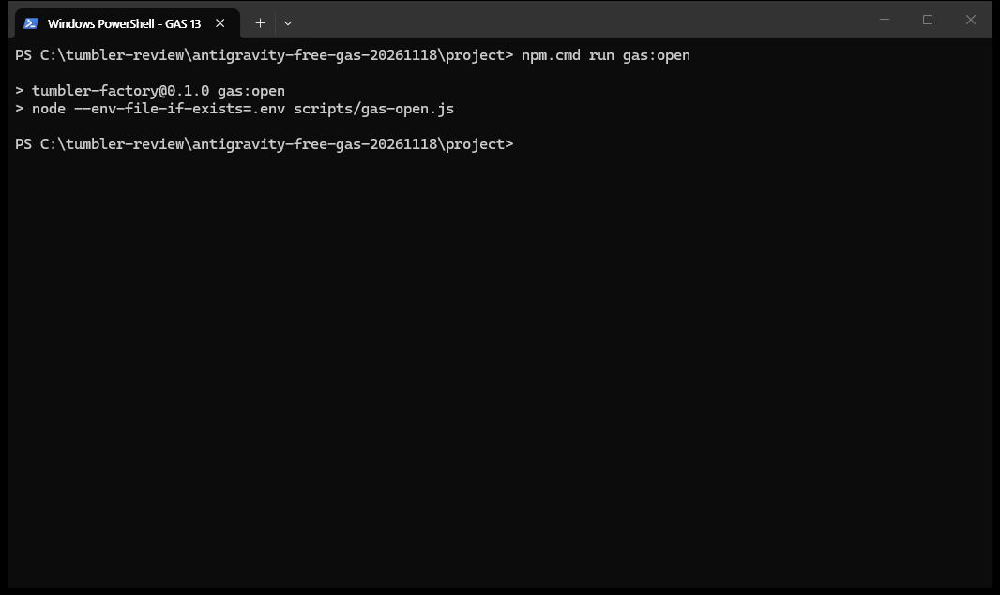

gas:open 실행 후 입력 줄로 돌아온 터미널 창

1. 프로젝트 이름이 **tumbler-factory**인지 확인하고 **REVIEW PERMISSIONS**(권한 검토)를 누릅니다. 계정을 묻는 화면에서는 3-7에서 사용한 수업 계정을 고릅니다.

   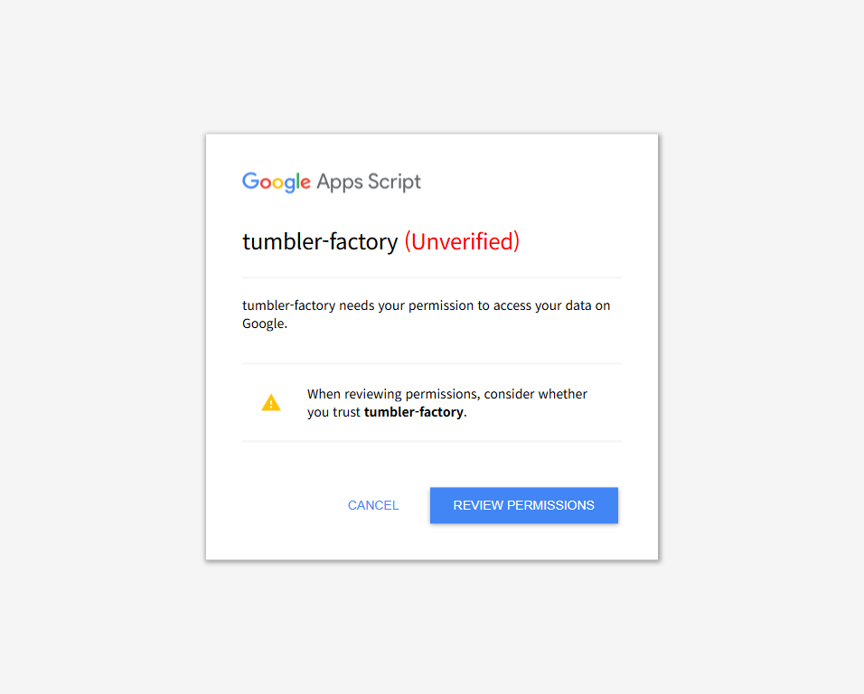

   tumbler-factory에서 권한 검토를 시작하는 버튼

2. 권한 목록에서 **모두 선택**을 누릅니다. 드라이브, 스프레드시트, 외부 서비스 세 항목에 체크가 표시됩니다.

   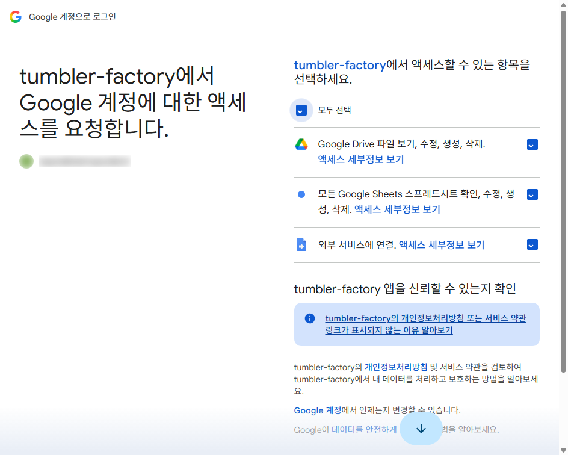

   모두 선택을 눌러 세 항목에 체크한 화면

3. 아래로 내려 **계속**을 누릅니다.

   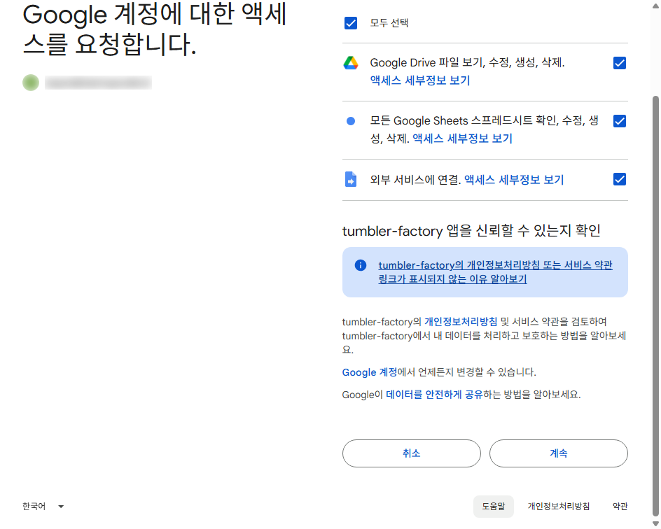

   권한 목록 아래의 계속 버튼

- 완료 기준: “권한 승인이 끝났습니다. 이 창을 닫고 터미널로 돌아가세요.”가 보이면 탭을 닫습니다. 처음부터 이 문구가 보이면 이미 승인된 상태입니다.

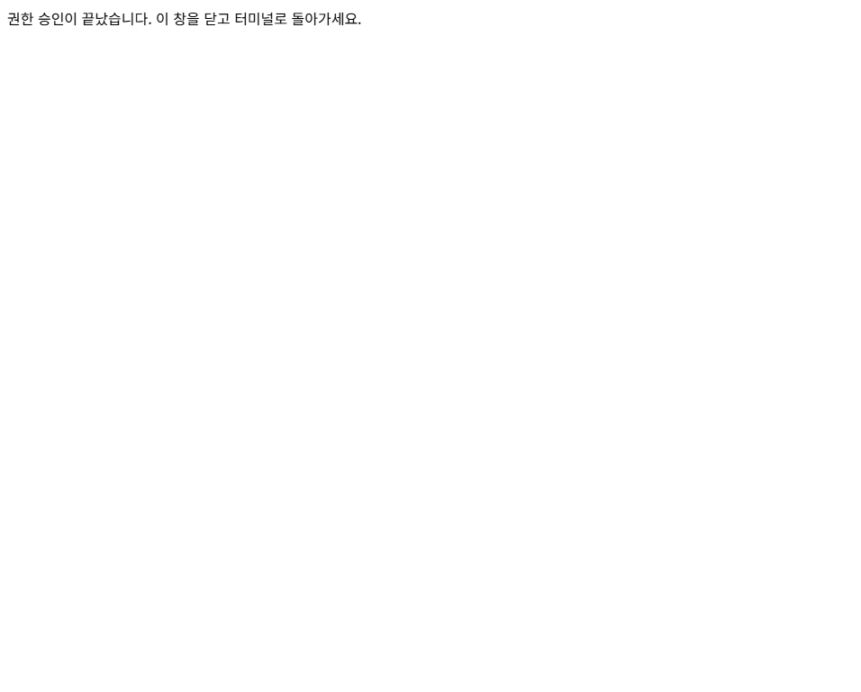

브라우저에 표시된 권한 승인 완료 문구

<details>
<summary>“Google에서 확인하지 않은 앱”이 표시될 때</summary>

앱 이름이 수업에서 만든 **tumbler-factory**인지 확인합니다. 맞으면 **고급**에서 **tumbler-factory(으)로 이동**을 선택합니다.

</details>

<details>
<summary>“현재 파일을 열 수 없습니다”가 뜰 때</summary>

오른쪽 위 계정 그림을 눌러 3-7에서 쓴 수업 계정을 고른 뒤, 열린 탭의 주소를 다시 엽니다. 수업 계정만 로그인된 창이 없으면 아래 “액세스 권한 필요”의 시크릿 창을 씁니다. 그래도 같으면 화면의 글을 “이렇게 나와요. 원인을 찾아 고쳐 주세요.”와 함께 AI에게 붙여 넣습니다.

</details>

<details>
<summary>“액세스 권한 필요”가 뜨거나 승인 직후 화면이 멈출 때</summary>

권한이 필요하다고 나오면 열린 주소를 복사합니다. ego (lite) 브라우저에서 `Ctrl+Shift+N`으로 시크릿 창을 열고 주소를 붙여 넣어 수업 계정으로 로그인합니다. 3-19나 3-20에서 다른 계정으로 열릴 때도 이 창을 씁니다. 승인 직후 화면이 멈췄다면 AI에게 `gas:open`을 한 번 더 실행해 달라고 합니다.

</details>

## 3-19. 검사 기록용 시트와 사진 폴더 만들기 (할 일) (Antigravity)

AI에게 아래 문장을 보냅니다.

```text
이 웹 서비스 폴더에서 npm.cmd run gas:init을 실행해 주세요.
시트와 사진 폴더가 준비되면 제가 열 수 있게 두 링크를 알려 주세요.
```

- 하는 일: 검사 기록용 시트와 사진용 폴더를 만들고 시트의 첫 줄을 확인합니다.
- 목표: 검사 한 건의 중량과 메모는 Google 시트에, 사진 파일은 드라이브 폴더에 저장할 곳을 준비합니다.

1. 명령 창에 **시트와 사진 폴더를 준비했습니다.**가 보입니다. AI가 알려 준 **시트** 링크를 엽니다. 아래 캡처에서는 개인 주소를 가렸습니다.

   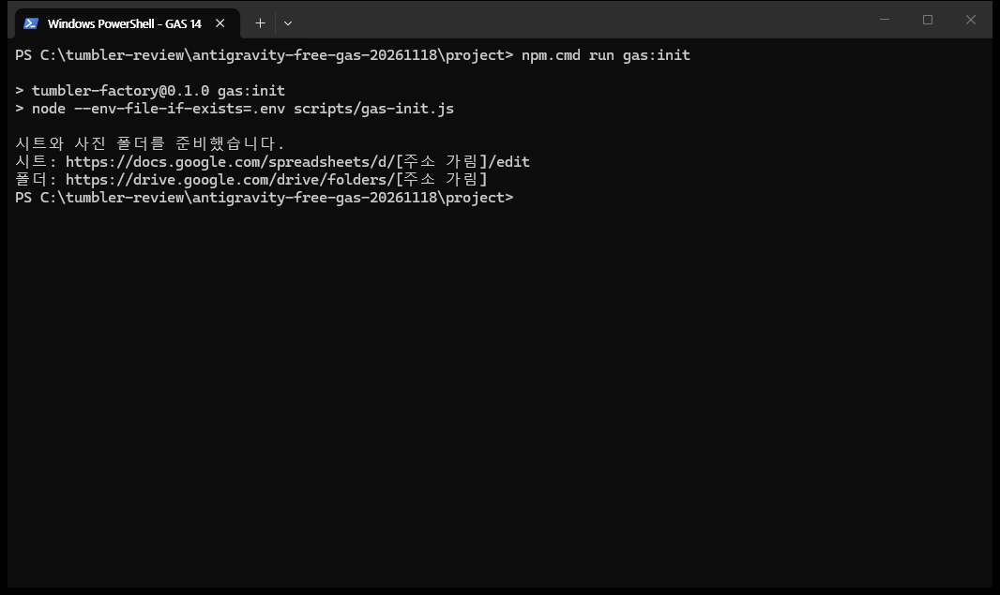

   시트와 사진 폴더를 만든 뒤 두 주소가 나온 터미널 창

2. 시트 제목이 **텀블러 공장 품질관리 데이터베이스**인지 확인합니다. 아래쪽 **inspections** 탭을 누르면 첫 줄에 검사 번호(`inspection_id`)부터 기록 버전(`content_version`)까지 8개 항목이 보입니다.

   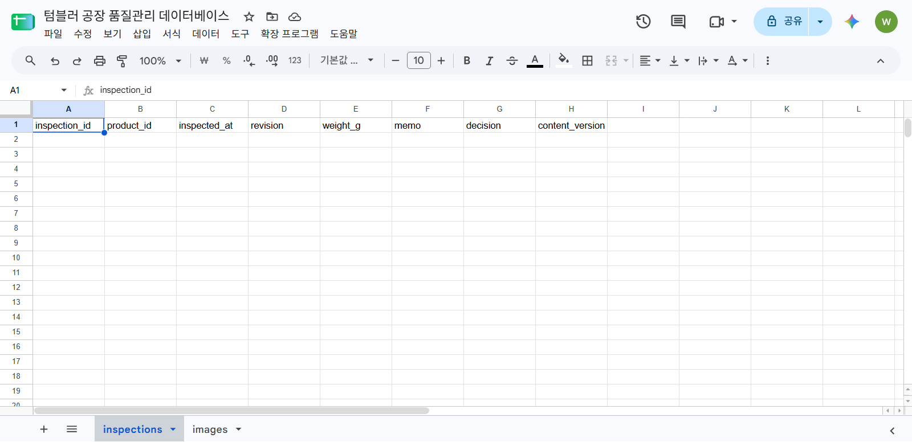

   inspections 탭의 첫 줄에 있는 검사 기록용 항목 8개

3. 옆의 **images** 탭을 누릅니다. 첫 줄에 검사 번호(`inspection_id`), 사진 순서(`position`), 사진 위치(`image_url`)가 보입니다.

   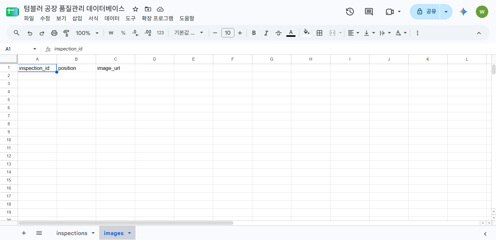

   images 탭의 첫 줄에 있는 사진용 항목 3개

- 완료 기준: 두 탭에 첫 줄만 있으면 준비가 끝났습니다. 시트는 다음 단계에서 다시 볼 수 있도록 열어 둡니다.

<details>
<summary>“Google에 연결하지 못했습니다”가 나오거나 시트 링크가 열리지 않을 때</summary>

연결 오류라면 3-18의 승인을 확인한 뒤 3-19 명령을 다시 실행해 달라고 합니다. 시트 링크만 열리지 않으면 수업 계정의 내 드라이브에서 **텀블러 공장 품질관리 데이터베이스**를 엽니다. 같은 이름이 여럿이면 이번에 준비한 시트의 수정 시각을 확인합니다.

</details>

## 3-20. Google 저장으로 켜고 등록하기 (할 일) (Antigravity)

### 3-20 (1) 대시보드를 Google 저장으로 켜기

서버 창 마지막 줄에 이미 **저장소: Google 시트·드라이브(live)**가 보이면 아래 할 일 2번으로 갑니다.

AI에게 아래 문장을 보냅니다.

```text
화면 서버를 다시 켜 주세요. Google 저장으로 켜졌는지 확인하고 대시보드 주소를 알려 주세요.
```

- 하는 일: 3-17에서 저장한 웹앱 주소를 대시보드가 읽도록 서버를 다시 켭니다.
- 목표: 이제 새로 등록하는 검사가 3-19에서 만든 시트와 폴더에 저장되게 합니다.

1. 서버 창 마지막에 **저장소: Google 시트·드라이브(live)**가 보이면 그대로 열어 둡니다. 서버가 실행 중이라 새 입력 줄이 나오지 않습니다.

   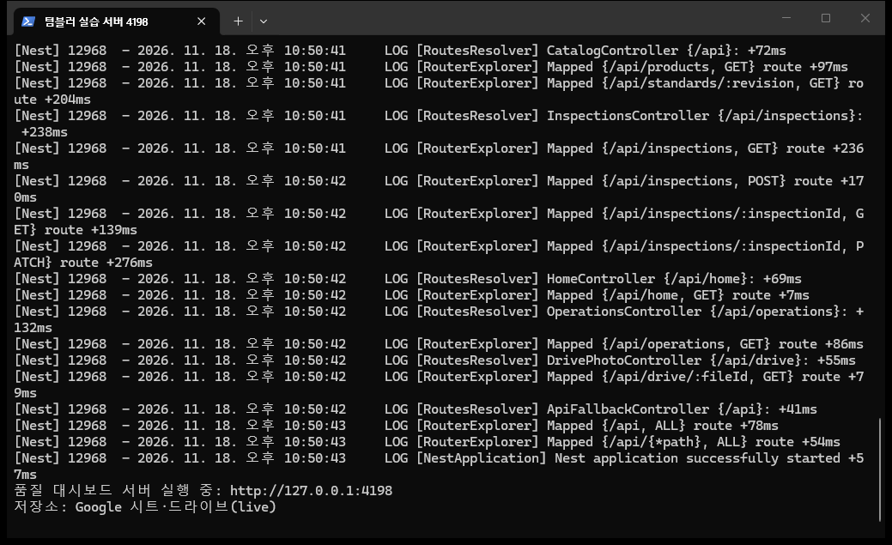

   실행 중인 서버의 전체 창. 마지막 두 줄에 이 실습의 대시보드 주소와 Google 저장소가 보입니다.

2. 서버 창에서 **품질 대시보드 서버 실행 중** 뒤에 나온 주소를 열고 실습 계정으로 로그인합니다. 오른쪽 위 **설정**을 눌러 서버 창과 같은 저장소 이름을 확인합니다.

   

   설정에 표시된 Google 시트·드라이브(live)

3. 왼쪽 위 로고를 눌러 홈으로 돌아갑니다.

   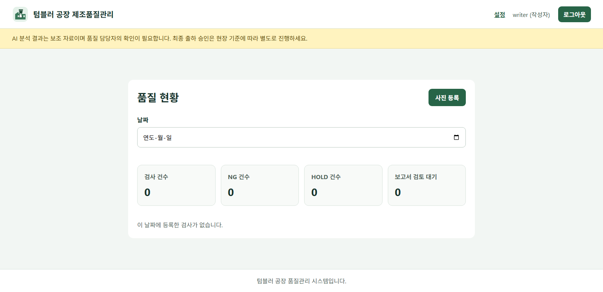

   비어 있는 새 Google 시트에 연결한 뒤의 품질 현황 홈

- 완료 기준: 설정에 **Google 시트·드라이브(live)**가 보이고, 처음 만든 시트라 홈의 **검사 건수**는 **0**입니다. 다음 단계에서 첫 검사를 등록합니다.

<details>
<summary>서버를 다시 켰는데 내 컴퓨터(mock)가 보이거나 시트·사진 폴더가 없다고 나올 때</summary>

설정이 **내 컴퓨터(mock)**이면 AI에게 `.env`의 `STORAGE_MODE`를 `live`로 바꾸고 서버를 다시 켜 달라고 합니다. 시트와 사진 폴더가 아직 없다는 안내가 나오면 3-19를 확인합니다.

</details>

### 3-20 (2) 검정 텀블러 사진 두 장으로 검사 등록하기

1. 홈에서 **사진 등록**을 누릅니다. 제품은 **검정 텀블러**를 고르고 **중량(g)**에 **550**을 적습니다.

   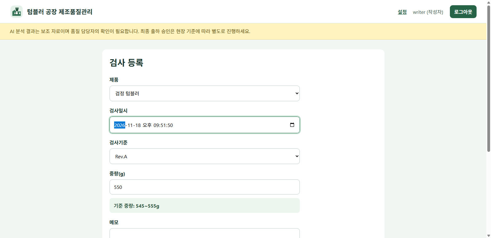

   검정 텀블러와 중량 550을 입력한 검사 등록 화면

2. **파일 선택**을 누릅니다. **TUM-PRC-003.jpg**를 클릭한 뒤, **Ctrl**을 누른 채 **TUM-PRC-007.jpg**를 클릭합니다. 두 장을 고르면 **열기**를 누릅니다.

   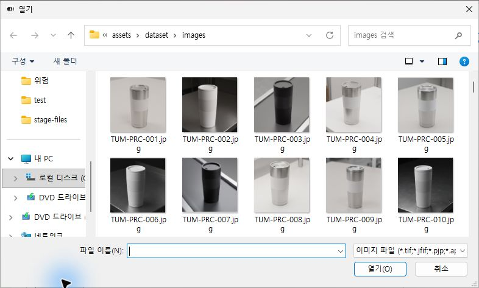

   Windows 파일 선택 창에 보이는 실습 사진 목록. 이 화면에서 검정 텀블러 사진 003과 007을 고릅니다.

   대시보드에 **파일 2개**와 검정 텀블러 사진 두 장이 보이면 **검사 등록**을 한 번 누릅니다.

   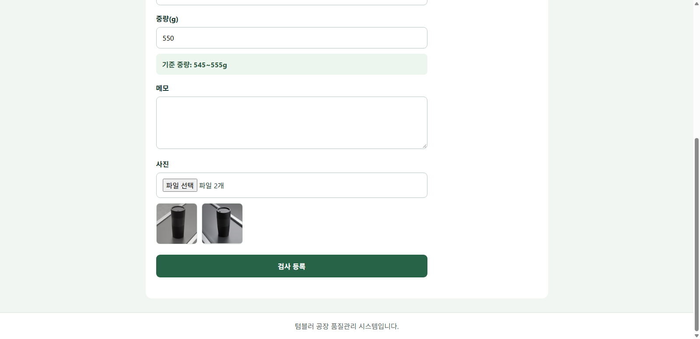

   파일 2개와 두 장의 미리보기가 보이는 상태에서 검사 등록을 누릅니다.

3. **검사 상세**가 열릴 때까지 기다립니다. 위쪽에 **검사 기록 버전: 0**, 사진 옆에 **550g**이 보입니다. 등록할 때 고른 검정 텀블러는 상세에서 **텀블러 블랙**으로 표시됩니다.

   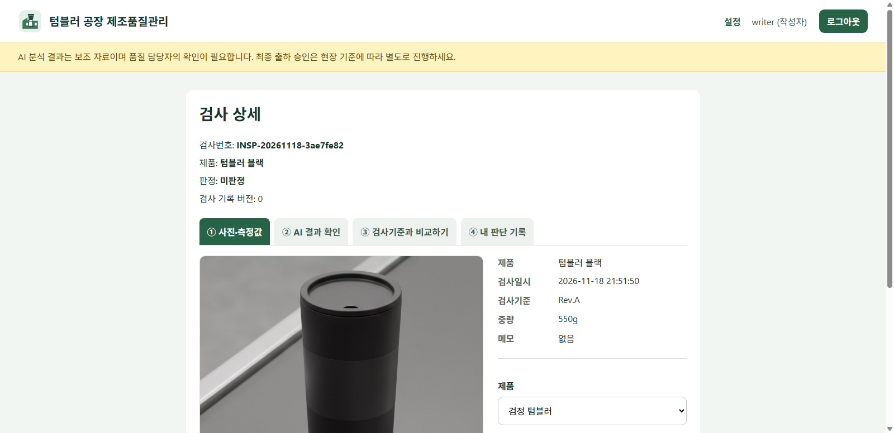

   새로 등록된 검사 상세의 버전 0과 중량 550g

- 하는 일: Google에 검사 한 건과 검정 텀블러 사진 두 장을 저장합니다.
- 목표: 3-16에서 내 컴퓨터에만 저장했던 검사와 구분되는 새 기록을 만듭니다.
- 완료 기준: **① 사진·측정값**에서 아래로 내려 큰 사진 밑에 작은 사진 두 장이 보이는지 확인합니다.

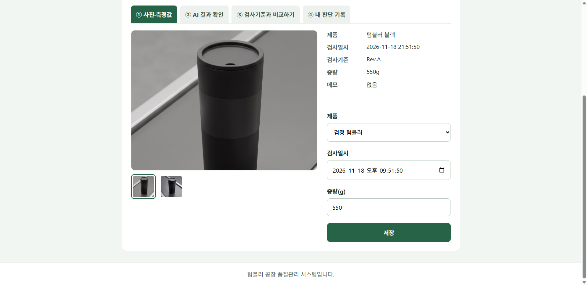

등록한 검정 텀블러 사진 두 장과 저장된 중량

<details>
<summary>등록을 눌렀는데 검사 상세나 두 번째 사진이 보이지 않을 때</summary>

등록 직후에는 사진이 늦게 보일 수 있습니다. 1분이 지나도 상세가 열리지 않으면 중복 등록을 피하도록 등록 버튼은 그대로 두고, 화면과 서버 창에 나온 글을 AI에게 보냅니다.

</details>

### 3-20 (3) 중량을 552g으로 고치고 다시 열어 보기

1. 검사 상세에서 아래로 내려가 **중량(g)**을 **552**로 바꾸고 **저장**을 한 번 누릅니다.

   

   중량 칸에 552를 입력한 뒤 바로 아래의 저장을 누릅니다.

2. 위쪽에서 **검사 기록 버전: 1**과 **552g**을 확인합니다. 버전은 이 기록을 한 번 수정했다는 뜻입니다.

   

   검사 상세에 버전 1과 552g이 표시됩니다.

3. 큰 사진을 마우스 오른쪽 버튼으로 누르고 **새 탭에서 이미지 열기**를 선택합니다. 검정 텀블러 사진이 열리고 주소에 `/api/drive/`가 들어 있으면 Google에 저장한 사진입니다.

   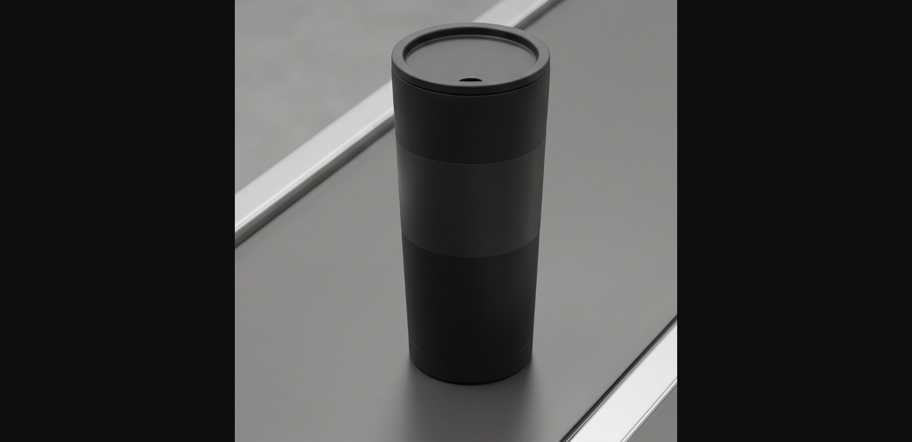

   새 탭에서 실제로 열린 검정 텀블러 사진

   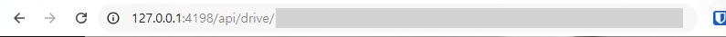

   새 탭 주소 표시줄의 /api/drive/ 부분을 확인합니다. 뒤의 개인 파일 번호는 가렸습니다.

4. 사진 탭을 닫고 대시보드 왼쪽 위의 **텀블러 공장 제조품질관리**를 눌러 홈으로 돌아갑니다. **F5**를 눌러 새로고침한 뒤에도 검사 카드에 **552g**이 보이면 됩니다.

   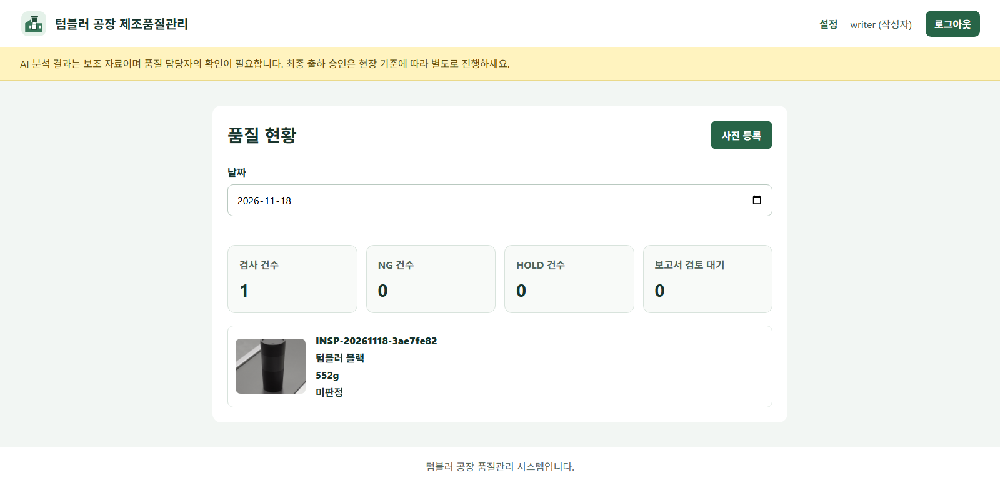

   새로고침한 뒤에도 552g이 남아 있는 홈 화면

- 하는 일: 이미 등록한 검사의 중량을 552g으로 바꿉니다.
- 목표: 사진이 그대로 열리고 홈을 새로고침해도 고친 값이 남는지 확인합니다.
- 완료 기준: 검사 기록 버전이 1이고, 드라이브 사진이 새 탭에서 열리며, 홈을 새로고침한 뒤에도 552g이 보입니다.

<details>
<summary>새 탭에서 연 사진 주소에 uploads가 보일 때</summary>

AI에게 “사진이 내 컴퓨터에서 나와요. 고쳐 주세요.”라고 보냅니다.

</details>

### 3-20 (4) Google 시트와 드라이브에서 검사 결과 확인하기

1. 3-19에서 만든 Google 시트를 열고 **새로고침**합니다. 아래의 **inspections** 탭을 누릅니다. 제목 바로 아래에 검사 한 줄이 있고, **weight\_g**는 **552**, **content\_version**은 **1**입니다.

   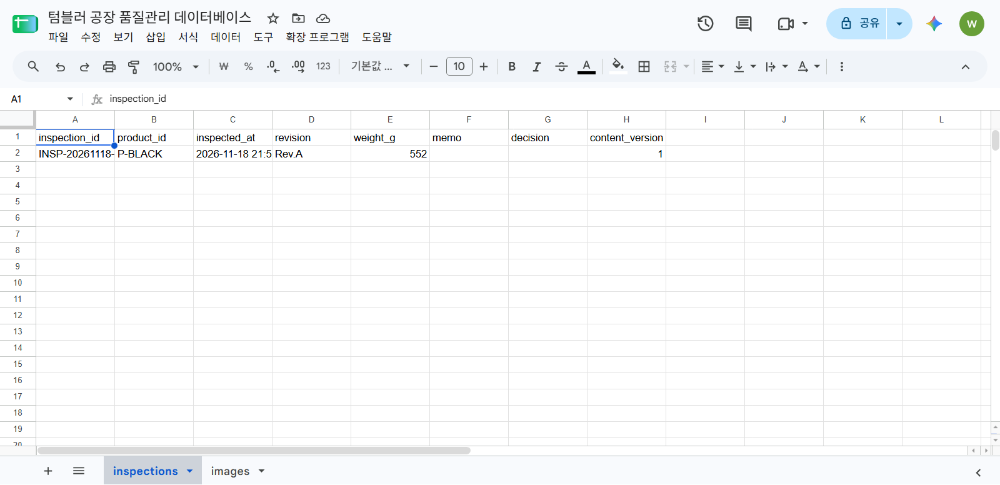

   inspections 탭의 검사 한 줄에 중량 552와 버전 1이 보입니다.

2. 아래의 **images** 탭을 누릅니다. 사진마다 한 줄씩 생겨 **position** 열에 **1**, **2**가 보입니다. **image\_url**은 두 줄 모두 `/api/drive/`로 시작합니다.

   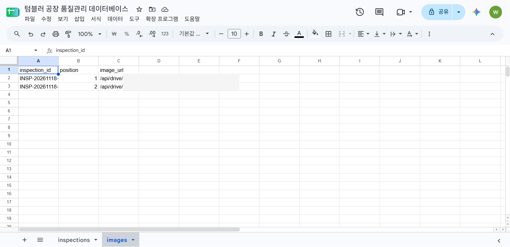

   두 사진의 순서와 저장 경로입니다. 캡처에서는 각 경로 뒤의 파일 번호를 가렸습니다.

3. 3-19에서 받은 **사진 폴더** 링크를 엽니다. 오른쪽 위에서 **그리드 보기**를 누르고, 검정 텀블러 사진 두 장을 확인합니다. 파일 이름은 저장할 때 바뀌므로 사진으로 구분합니다.

   

   Google 드라이브에서 확인한 두 장의 검정 텀블러 사진

- 하는 일: 대시보드에서 저장한 검사 한 건을 Google 시트와 드라이브에서 확인합니다.
- 목표: 시트에는 중량과 사진 순서가, 드라이브에는 사진 원본이 저장됐는지 확인합니다.
- 완료 기준: 시트에 중량 552와 버전 1인 검사 한 줄, 사진 순서 1·2인 두 줄이 보이고, 드라이브 폴더에 검정 텀블러 사진 두 장이 보입니다.

## 3회차 끝 확인

- [ ] 설정과 서버 창에 `저장소: Google 시트·드라이브(live)`가 보입니다.
- [ ] 홈 검사 카드에 **552g**이 남아 있고, 검사 상세의 기록 버전은 **1**입니다.
- [ ] Google 시트의 `inspections`에 검사 한 줄, `images`에 순서가 1과 2인 사진 두 줄이 보입니다.
- [ ] Google 드라이브의 사진 폴더에 등록한 검정 텀블러 사진 두 장이 보입니다.

## 참고

### 완료 후 선택 실습

<details>
<summary>중량을 한 번 더 고쳐 보기</summary>

검사 상세의 1번 탭에서 중량을 **553g**으로 바꾸고 **저장**을 누릅니다. 기록 버전이 한 번 더 오릅니다. 가이드의 최종 화면은 552g 상태입니다.

</details>

<details>
<summary>내 컴퓨터 저장을 확인한 뒤 Google 저장으로 돌아오기</summary>

1. AI에게 `.env`의 `STORAGE_MODE`를 `mock`으로 바꿔 달라고 합니다. AI가 서버를 다시 켜 둡니다.
2. 서버 창에 `저장소: 내 컴퓨터(mock)`가 보입니다.
3. 브라우저를 새로고침하고 다시 로그인합니다. "설정"에 같은 문장이 보입니다. 홈에서 2회차에 내 컴퓨터에 저장한 검사를 확인합니다. 검사가 없으면 사진 한 장으로 새로 등록합니다. 3-20에서 Google에 저장한 검사는 내 컴퓨터로 옮겨지지 않습니다.
4. AI에게 `STORAGE_MODE`를 다시 `live`로 바꿔 달라고 합니다. AI가 서버를 다시 켜 둡니다. 서버 창에 `저장소: Google 시트·드라이브(live)`가 보이면 됩니다.

</details>
