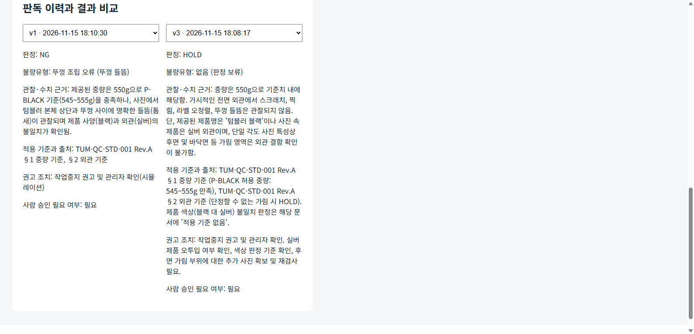
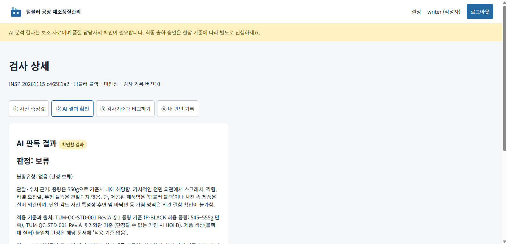

# 4회차: Gemini 사진 판독

> AI 도구에서 같은 프로젝트 폴더를 열고 프롬프트를 하나씩 보냅니다. 결과를 직접 확인한 뒤 다음으로 넘어갑니다. 오류가 나면 오류 문구를 그대로 보내 해결을 요청하세요. 화면은 예시와 달라도 됩니다.
>
> 실제 현장 정보 대신 수업용 자료를 사용합니다.

## 완성 예시





## 준비

3회차 프로젝트 폴더를 열고 서버를 켭니다.

## 따라하기

```text
https://github.com/startup-life/manufacturing-quality-dashboard-student 에서 prompts 폴더를 가져와줘. standards의 검사기준과 사진 판독 지시문을 수업용 원문으로 사용해줘.
```

```text
검사 상세에 AI 사진 판독 버튼을 만들어줘. 우선 연습용 결과로 작동시키고 실제 판독과 구분해 표시해줘. 사진에서 확인할 수 없는 내용은 추측하지 말고, 최종 판단은 사람이 한다고 알려줘.
```

```text
OnePort를 통해 Gemini로 사진을 판독하게 연결해줘. API 키는 내가 직접 비공개 설정에 넣게 하고 화면과 Git에 노출하지 마. 실제 연결이 실패하면 이유를 표시해줘.
```

```text
판독 결과와 시각을 검사 기록에 저장하고 다시 열어 볼 수 있게 해줘. 사진이나 검사 정보가 바뀌면 이전 판독을 다시 확인하라고 알려줘.
```

## 직접 확인

- 연습용 결과가 실제 결과와 구분되는지 확인합니다.
- 실제 연결 후 사진 판독을 실행하고 저장된 결과를 다시 열어 봅니다.
