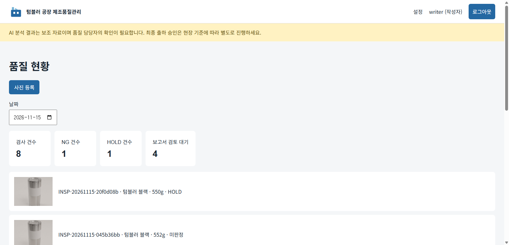
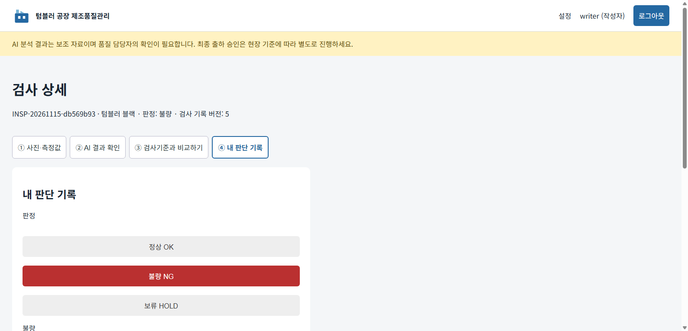

# 6회차: 사람의 판단과 이력

> AI 도구에서 같은 프로젝트 폴더를 열고 프롬프트를 하나씩 보냅니다. 결과를 직접 확인한 뒤 다음으로 넘어갑니다. 오류가 나면 오류 문구를 그대로 보내 해결을 요청하세요. 화면은 예시와 달라도 됩니다.
>
> 실제 현장 정보 대신 수업용 자료를 사용합니다.

## 완성 예시





## 준비

5회차 프로젝트 폴더를 열고 서버를 켭니다.

## 따라하기

```text
검사 상세에 사람이 최종 판단을 남기는 화면을 만들어줘. 판정은 정상(OK), 불량(NG), 보류(HOLD) 중에서 고르고, 불량 내용과 조치 메모, 판단 이유를 기록하게 해줘. 중량이 미측정이면 정상으로 저장하지 못하게 해줘. AI 결과는 참고이며 출하 승인으로 자동 처리하지 마.
```

```text
판단을 바꿀 때 변경 이유와 시각을 이력으로 남기고, 홈과 목록에는 가장 최근 판단을 표시해줘. 내 컴퓨터와 Google 저장 방식 모두에서 이력이 남게 해줘.
```

```text
사진 등록부터 AI 판독, 기준 확인, 사람의 판단과 조치 기록까지 순서대로 점검해줘. 연결되지 않은 서비스가 있어도 사람은 직접 판단할 수 있게 해줘.
```

## 직접 확인

- 판단을 저장하고 수정한 뒤 변경 이력을 확인합니다.
- 서버를 다시 켜고 저장 방식에 맞는 기록이 남아 있는지 확인합니다.
